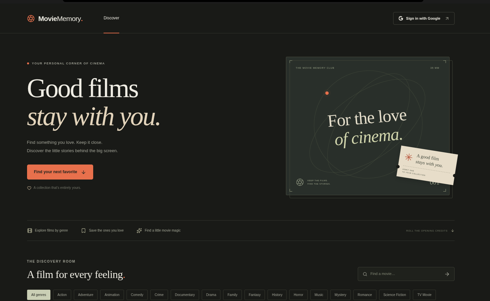
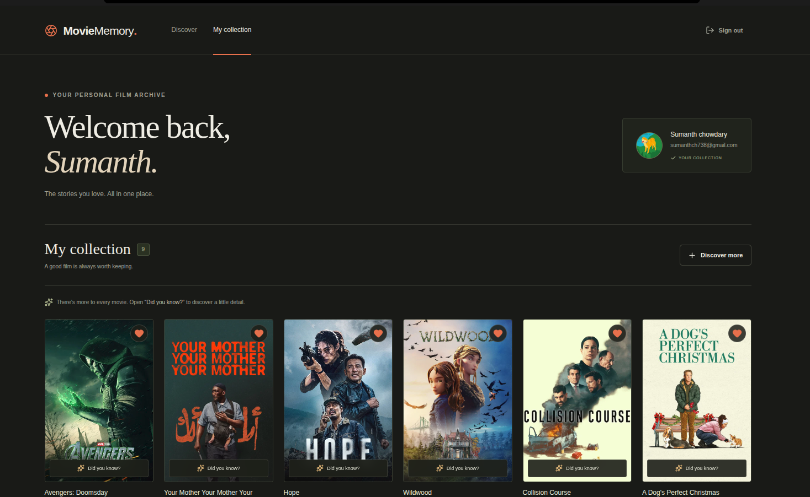
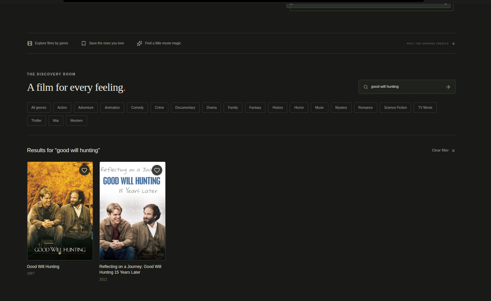
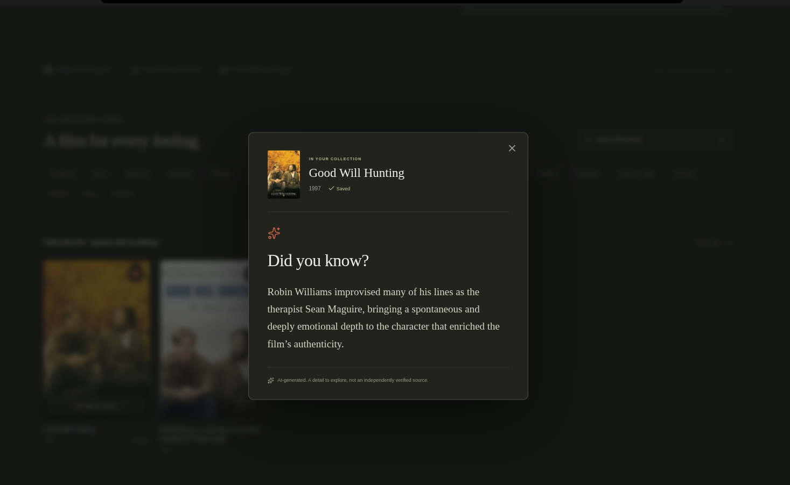

# Movie Memory

Save the movies you love and discover a short fact about each one. Sign in with Google, choose your first favorite, and build your collection.

[Live app](https://moviememory.vercel.app/) · [GitHub repository](https://github.com/SumanthAitham/Favourite-Movies) · [Architecture](docs/ARCHITECTURE.md) · [Requirements checklist](docs/REQUIREMENTS.md)

Built with **Next.js, TypeScript, React, Tailwind CSS, PostgreSQL, Prisma, Auth.js, and OpenAI**. Movie search and posters come from TMDB.

## What the app does

- Signed-out visitors see the landing page and **Sign in with Google**.
- New users choose a favorite during onboarding; returning users go to their dashboard.
- The dashboard shows the Google name, email, photo (or a fallback), saved movies, and sign-out button. Signed-out visitors cannot access it.
- Saving a movie opens **Did you know?**, with an OpenAI-generated fact stored in the database.
- Genre browsing, search, and multiple favorites extend the basic exercise.

## Run locally

You need **Node.js 22.12+**, npm, PostgreSQL (or Docker Compose), and Google OAuth, TMDB, and OpenAI credentials.

```bash
npm ci
# Copy this only if you don't already have a .env file:
cp .env.example .env
```

Fill in `.env` using the table below. For the included local database, keep the example database URL, then run:

```bash
docker compose -p movie-memory up -d --wait
npm run db:migrate
npm run dev
```

Open **http://localhost:3000**. If using hosted PostgreSQL, supply its connection URL and skip the Docker step. `db:migrate` applies committed migrations; use `npm run db:dev` when creating a new migration.

### Environment variables

| Variable | What to put here |
| --- | --- |
| `DATABASE_URL` | PostgreSQL connection string; the template matches local Docker. |
| `DIRECT_DATABASE_URL` | Optional direct database URL for migrations when using a pooler. |
| `AUTH_SECRET` | Generate with `openssl rand -base64 32`. |
| `AUTH_URL` | `http://localhost:3000` locally; your app's origin in production. |
| `AUTH_GOOGLE_ID` | Google OAuth web client ID. |
| `AUTH_GOOGLE_SECRET` | Google OAuth web client secret. |
| `TMDB_READ_ACCESS_TOKEN` | TMDB API Read Access Token, not the v3 API key. |
| `OPENAI_API_KEY` | OpenAI API key with available API quota. |
| `OPENAI_MODEL` | Optional; defaults to `gpt-4.1-mini`. |

In Google Cloud, create an OAuth **Web application**, configure the consent screen and test users, and add:

- Origin: `http://localhost:3000`
- Redirect URI: `http://localhost:3000/api/auth/callback/google`

For Vercel, set the same environment variables, change `AUTH_URL` to `https://moviememory.vercel.app`, and register `https://moviememory.vercel.app/api/auth/callback/google` with Google. Apply migrations to the production database before using the app. Restart locally or redeploy after changing environment variables.

Keep `.env` out of Git and use placeholders in `.env.example`. Provider keys stay on the server.

## Architecture and Variant A

One Next.js app handles the UI and API routes. Auth.js manages Google login and database sessions; Prisma handles PostgreSQL. `User` stores the profile and onboarding status, `Movie` stores shared TMDB metadata, `Favorite` links a user to a movie, and `MovieFact` stores that user's generated facts. Unique favorites prevent duplicate saves, while separate onboarding status lets returning users empty their collection without starting over.

**Variant A** was chosen to focus on backend correctness: caching, concurrent requests, and useful behavior when a provider fails.

1. Check the signed-in user's ownership of the favorite.
2. Return their latest fact if it is less than **60 seconds** old.
3. Otherwise, acquire a PostgreSQL advisory lock, recheck the cache, generate through OpenAI, and save the result. A local promise map also shares requests within one process.
4. If generation fails or times out, return the older fact without changing its timestamp. If none exists, show a friendly error with retry.

PostgreSQL serves as the cache, so **Redis is not used**. The last five facts guide new generations; a wording check rejects exact and near-verbatim repeats. It cannot catch every paraphrase or guarantee factual accuracy.

All personal reads and writes use the server session. Movie input is validated server-side, and missing Google names or photos have fallbacks. The [architecture overview](docs/ARCHITECTURE.md) explains the schema, request flow, locking, and failure handling in more detail.

### Tradeoffs

- Database locks coordinate multiple app instances, but hold a connection while generation runs. Timeouts bound this wait.
- Saving a favorite and generating its fact are separate, so an OpenAI outage cannot undo the save.
- Facts refresh on demand after expiry. Older facts remain available as fallback; there is no background refresh.
- Multiple favorites and TMDB discovery add scope. Variant B's inline editing and client-cache requirements are outside this submission.

## Verification

```bash
npm run typecheck
npm run lint
npm test
npm run build
```

Last recorded checks passed: **168 unit/handler tests**, **7 PostgreSQL integration tests**, one live OpenAI pipeline test, lint, and the production build. Tests cover the 60-second boundary, concurrent generation, cross-user access, validation, and failure fallback.

The default suite skips database and live-provider tests. With the local database migrated, run `npm run test:database`; run `npm run test:openai` with provider credentials and a locally stored movie (`OPENAI_SMOKE_TMDB_ID`, default `272`). Both refuse hosted databases, so point `DATABASE_URL` at the local database from `.env.example` when running them. The OpenAI test uses API quota.

Full Google login/logout, mobile layout, and keyboard interactions still need browser acceptance testing. See the [checklist](docs/REQUIREMENTS.md) for details.

## Screenshots

**Landing page** — discover movies and sign in with Google.



**My collection** — your profile and saved favorites in one place.



**Movie search** — find a film and add it to your collection.



**Did you know?** — open a saved movie to read its AI-generated fact.



## With two more hours

- Finish browser checks and add an end-to-end regression test for login, onboarding, and the fact dialog.
- Add per-user generation limits and basic error/latency monitoring.
- Review dependency updates. For higher traffic later, move generation to a durable job queue.

## AI usage

- Used Codex for scaffolding, implementation, and refactoring.
- Used it to write and run tests, investigate failures, and review authorization checks.
- Used it to help draft documentation. Automated checks and unverified browser flows are reported separately above.

Movie metadata and images come from [TMDB](https://www.themoviedb.org/). This product uses the TMDB API but is not endorsed or certified by TMDB.
